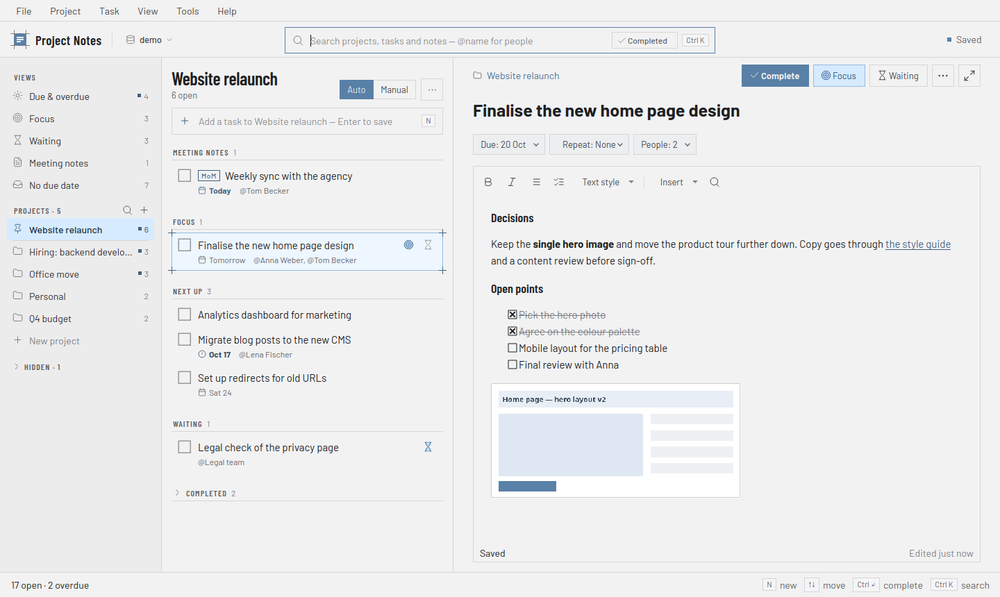
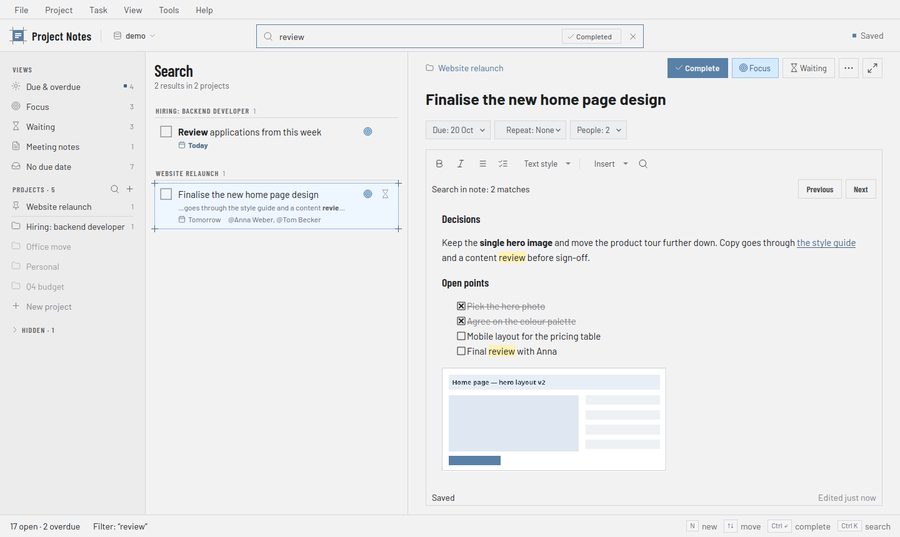

# Project Notes

A desktop app for keeping projects, tasks and notes in one place. Each task has its own rich-text note, so meeting minutes, decisions and screenshots stay next to the work they belong to. Everything is stored in a local SQLite file.

Built with Python and PyQt6.



## Getting started

You need Python 3.11 or newer.

```bash
python3 -m pip install -r requirements.txt
python3 app.pyw
```

The first launch creates a database with a sample project. You can create or open other databases from the **File** menu and switch between them in the top bar.

## How it's organised

The window has three panes:

- **Sidebar**: smart views across all projects (Due & overdue, Focus, Waiting, Meeting notes, No due date), then your projects. Projects you hide, and projects with nothing left to do, move to a collapsible **Hidden** section.
- **Task list**: the tasks of the open project or view, grouped into Focus, Next up, Waiting, Meeting notes and Completed. Type in the box at the top and press Enter to add a task. Switch to **Manual** to order tasks by dragging.
- **Task details**: title, due date, repeat, people and the note. The arrows button in the top-right corner gives the note the whole window.

Completing, deleting or moving tasks shows a notice with **Undo**.

## Working with tasks

- Mark tasks as **Focus** (what you're working on now), **Waiting** (on someone else) or **Meeting notes**.
- Give tasks due dates, or snooze them to later today, tomorrow, the weekend or next week.
- Repeat tasks daily, weekly, monthly, or a set time after you complete them.
- Add people to tasks. Names you've used before are suggested as you type.
- Select several tasks with Ctrl+click or Shift+click to complete, move, duplicate or flag them all at once.
- **Merge tasks** (right-click → Merge Tasks…) combines several tasks of one project into a new one. The new task's note contains each merged note under its task's title. The merged tasks are completed, and each of their notes ends with a link to the new task.
- Import and export tasks as CSV, or copy the current list as plain text.

When you complete a task, the date is added to the end of its note.

## Notes

Notes save automatically as you type. They support bold, italic, headings, lists, checklists, links and highlighting. Typing `- `, `1. `, `# ` or `[] ` at the start of a line starts a list, heading or checklist.

Paste or drop images straight into a note. Click an image to resize, crop or copy it, or to fit it to the width of the note. Resizing and cropping can be undone. Ctrl+F finds text in the open note.

If a note can't be saved (because the disk is full, say), it stays open with options to retry, export it as HTML, or discard the changes. Nothing is lost silently.

## Search



Press Ctrl+K and type. Every word has to appear somewhere in the project name, task title or note. Case and accents don't matter, so `cafe` finds "Café" and `ταξιδι` finds "Ταξίδι". Title matches come first, and when a word only appears in a note, the result shows that line.

| Type | To find |
|---|---|
| `"exact phrase"` | the phrase as written |
| `-word` | tasks without that word |
| `@anna` or `@"Anna Weber"` | tasks with that person |
| `in:website` | tasks in projects whose name contains "website" |
| `is:open` / `is:done` | only open or only completed tasks |

Completed tasks are left out unless you turn on **Completed** in the search box (Alt+C).

## Reviews

**Project → Start Review** takes you through your projects one at a time, starting with the ones you reviewed longest ago. If some projects are hidden, you choose whether to include them: none, only those with open tasks, or all of them.

The review panel shows what needs attention in the open project. **Reviewed, Next** (Ctrl+Shift+R) marks it as reviewed and opens the next one. **Skip** moves a project to the end, so it comes back after all the others. A review in progress carries on after you restart the app.

## Backups

Each time you close the app, it backs up the database to a `<database name>_backups` folder next to it, together with a copy of the note images. The latest 30 backups are kept.

Each backup is a `.sqlite` file plus a `.assets` folder with the same name. To restore one:

1. Copy the backup file into an empty folder and rename it to the original database name (you'll find it in `restore.json` inside the `.assets` folder).
2. Copy the attachment folder from inside `.assets` next to it.
3. Open it with **File → Open Database…**.

## Keyboard shortcuts

| Shortcut | Action |
|---|---|
| Ctrl+K | Search (Esc clears it) |
| Ctrl+P | Go to a project |
| N or Ctrl+N | Add a task |
| Ctrl+Shift+N | Add a project |
| ↑ ↓ or J K | Move through tasks |
| Ctrl+Enter | Complete or reopen the selected tasks |
| Ctrl+D | Set a due date |
| Delete | Delete the selected tasks |
| F2 | Rename a project or task |
| Ctrl+Shift+R | Reviewed, next project |
| Esc | Leave the full-window note |

N, J, K, the arrow keys and Delete work when you're not typing in a text field. In notes, Ctrl+L adds a link and Ctrl+Shift+C ticks a checklist item.

## License

GNU General Public License v3.0, see [LICENSE](LICENSE).

The bundled Barlow and Barlow Condensed fonts are under the SIL Open Font License ([fonts/OFL.txt](fonts/OFL.txt)). The icons in `icons/lucide/` are from [Lucide](https://lucide.dev) (ISC License).
